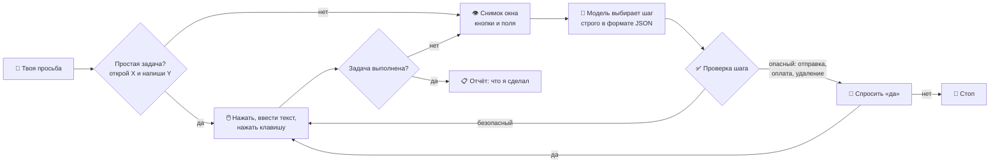
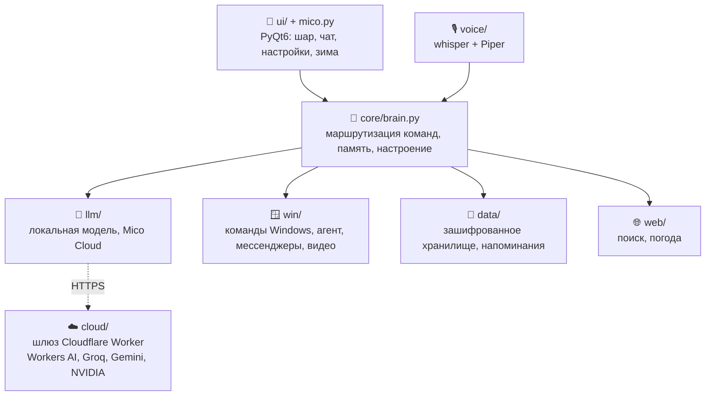

<div align="center">

# 🌟 Mico AI

### Живой ИИ-компаньон для Windows 11

**Он живёт на рабочем столе, понимает человеческую речь, управляет компьютером, пишет друзьям в Telegram, включает видео и помнит, чем ты занимался.**

[](https://github.com/Serdzh29/Mico-AI/actions/workflows/tests.yml)


[🌐 Сайт](https://serdzh29.github.io/Mico-AI/) · [⬇️ Скачать](https://github.com/Serdzh29/Mico-AI/releases/latest) · [📜 История версий](CHANGELOG.md) · [🔒 Приватность](PRIVACY.md) · [🐞 Сообщить о проблеме](../../issues)

</div>

---

## 📖 Содержание

- [✨ Что такое Mico AI](#-что-такое-mico-ai)
- [🤖 ИИ-агент: Mico сам нажимает кнопки](#-ии-агент-mico-сам-нажимает-кнопки)
- [🧠 Два мозга: облако и локальная модель](#-два-мозга-облако-и-локальная-модель)
- [☁️ Mico Cloud: уровни Lite, Plus и Max](#️-mico-cloud-уровни-lite-plus-и-max)
- [🚀 Все возможности](#-все-возможности)
- [🗣️ Голос](#️-голос)
- [🎭 Характер, эмоции и зимнее оформление](#-характер-эмоции-и-зимнее-оформление)
- [🔒 Приватность и безопасность](#-приватность-и-безопасность)
- [📋 Требования](#-требования)
- [📥 Установка](#-установка)
- [⚙️ Настройки](#️-настройки)
- [🛠️ Если что-то не работает](#️-если-что-то-не-работает)
- [👩‍💻 Для разработчиков](#-для-разработчиков)
- [🗺️ Чего Mico пока не умеет](#️-чего-mico-пока-не-умеет)
- [📄 Лицензия](#-лицензия)

---

## ✨ Что такое Mico AI

**Mico AI** — это милый персонаж-шарик на рабочем столе Windows. Щёлкни по нему или нажми <kbd>F8</kbd>, и откроется чат. Напиши обычными словами, что нужно, и Mico сделает:

> 💬 «открой телеграм и напиши маме привет»
> 💬 «громкость 30, а потом таймер на 10 минут»
> 💬 «о чём мы говорили вчера?»
> 💬 «найди в интернете рецепт борща»
> 💬 «что тормозит мой компьютер?»

### 🌈 Коротко о главном

| | Возможность | Что это значит |
|---|---|---|
| 🤖 | **ИИ-агент (BETA)** | Сам открывает программы, находит контакт, нажимает кнопки и вводит текст. Перед отправкой и оплатой спрашивает «да» |
| ☁️ | **Mico Cloud** | Облачные модели без ключей и без нагрузки на ПК. Три уровня и режим «Авто» |
| 🧠 | **Локальная модель** | Работает офлайн (GGUF, llama.cpp), видеокарта NVIDIA ускоряет её, если есть |
| 🖥️ | **Управление Windows** | Программы, сайты, окна, громкость, яркость, Wi-Fi, Bluetooth и более **130 переключателей** настроек |
| 🎙️ | **Голос** | Говорит и слушает: распознавание и озвучка работают на твоём ПК, звук не сохраняется |
| 🕐 | **Память** | «Что я делал час назад?», «о чём говорили про принтер?» |
| 😊 | **17 настроений** | Эмоции отражаются в мимике, губах, бровях и наклоне головы |
| ❄️ | **Зимнее оформление** | Снег, ёлки, гирлянда и красный колпак с живым помпоном |
| 🔒 | **Приватность** | Журналы зашифрованы и лежат на ПК, снимки экрана в облако не уходят |

---

## 🤖 ИИ-агент: Mico сам нажимает кнопки

Режим агента превращает Mico из собеседника в **настоящего помощника, который работает за компьютером вместо тебя**. Он видит, что открыто в активном окне (названия кнопок и полей через Windows UI Automation), решает, что нажать, и делает это.

> ⚠️ Режим агента помечен **BETA** и по умолчанию **выключен**. Включается в ⚙ Настройки → **Действия на ПК → Агент**.

### 💡 Примеры

| Что сказать | Что сделает Mico |
|---|---|
| `агент, открой телеграм и напиши маме привет` | Откроет Telegram, найдёт контакт «Мама», проверит открытый чат, спросит «да» и отправит |
| `агент, открой блокнот и напиши привет` | Откроет Блокнот и напечатает текст (быстро, без обращения к модели) |
| `агент, открой ютуб и включи видео про котов` | Найдёт видео, нажмёт на подходящее и включит |
| `открой блокнот и напиши список дел` | Если режим агента включён, тоже идёт агенту, фразу «агент,» писать не нужно |
| `агент` | Покажет подсказку, что умеет агент |
| `стоп агент` | Немедленно остановит задачу |

### 🔁 Как агент работает



1. **Разбор.** Mico понимает фразы вроде «открой телеграм и напиши алексею привет» и даже падежи имён: «алексею» → «Алексей», «мамуле» → «Мамуля».
2. **Взгляд на окно.** Агент читает названия кнопок, пунктов меню, вкладок и полей. Пароли и поля паролей он не трогает, окна банков и кошельков пропускает.
3. **Шаг.** Модель выбирает **одно действие** из каталога. Ответ принимается только как корректный JSON, а если модель ошиблась, ей дают исправиться.
4. **Проверка и подтверждение.** Всё, что уходит наружу или необратимо меняет данные, выполняется только после твоего «да».
5. **Результат.** После задачи Mico присылает карточку «Что я сделал» по шагам и, если действие обратимо, предлагает отменить последний шаг.

### 🧰 Что умеет агент

| Действие | Что делает |
|---|---|
| `launch` | Открывает программу по названию (в том числе установленные «для себя» Telegram, MAX, WhatsApp, Discord) |
| `focus` | Переходит в уже открытое окно, искать можно по-русски: «телеграм», «ватсап», «макс», «тимс» |
| `click` | Нажимает кнопку, ссылку, вкладку, пункт меню, флажок |
| `fill` | Заполняет поле по названию, включая строку адреса и поиска |
| `type` | Печатает текст в активное поле, **кириллица и эмодзи вводятся надёжно** (SendInput, юникод) |
| `press` | Нажимает клавиши и сочетания: Enter, Tab, Esc, Ctrl+F, Ctrl+L, стрелки, PageUp/PageDown и клавиши видеоплеера |
| `wait` | Ждёт, пока программа откроется |
| `done` | Завершает задачу и коротко отвечает |

### 💬 Мессенджеры

Telegram · MAX · WhatsApp · Viber · Discord · Microsoft Teams

Агент открывает программу, вызывает поиск (в каждом мессенджере своя клавиша: `Ctrl+F`, `Ctrl+K`, `Ctrl+E`), вводит имя контакта, выбирает верхний результат, **показывает, в какой чат попал и что отправит, и ждёт твоё «да»**.

### 🎬 Видео

YouTube · Rutube · VK Видео · Яндекс Видео

Поиск ролика, выбор из выдачи и команды плеера: пауза, полный экран, субтитры, звук, следующее видео.

### 🛡️ Защита и контроль

- ✅ **Подтверждение «да»** перед отправкой, публикацией, лайком, комментарием, подпиской, оплатой, заказом и удалением.
- 💳 **Покупки спрашиваются дважды.** Перед оплатой Mico покажет цену и дату, найденные на экране.
- ⏱️ **Ожидание ответа — 60 секунд.** Если ты не ответил, действие не выполняется.
- 🛑 **«Стоп агент»** прерывает задачу в любой момент, в том числе во время вопроса.
- 🔢 **Лимит шагов** задаётся в настройках, чтобы агент не ходил по кругу.
- 🚫 **Зоны** включаются отдельно: программы, мессенджеры, видео.
- 📸 **Снимки шагов** для отчёта лежат только на твоём ПК в `%APPDATA%\Mico\agent_steps`.
- 🔐 **Умные поля** (имя, телефон, почта) подставляются только после «да».
- 📝 **Журнал агента** `%APPDATA%\Mico\agent.log` хранится локально и помогает разобраться, если что-то пошло не так.

> ☁️ **Про приватность агента.** Если выбрано «Облако Mico» (режим по умолчанию) или облачный API, то названия кнопок и полей активного окна, заголовок окна и сама задача уходят в облако вместе с запросом на следующий шаг. Снимки экрана в облако не отправляются. Хочешь, чтобы окна не покидали ПК, выбери локальную модель в ⚙ Настройки → Модели. Подробности в [PRIVACY.md](PRIVACY.md).

---

## 🧠 Два мозга: облако и локальная модель

| | ☁️ Облако Mico (по умолчанию) | 🏠 Локальная модель |
|---|---|---|
| **Где отвечает** | Шлюз Mico на Cloudflare, модели Cloudflare, Groq, Gemini и NVIDIA | Прямо на твоём ПК |
| **Ключи** | Не нужны | Не нужны |
| **Интернет** | Нужен | Нужен только для скачивания модели, погоды и поиска |
| **Нагрузка на ПК** | Нет | Процессор, а с видеокартой NVIDIA быстрее |
| **Качество** | Сильные модели, три уровня | Одна модель Qwen3.5 4B (GGUF, около 3 ГБ) |
| **Что уходит наружу** | Текст чата и короткая история. При включённом агенте ещё названия кнопок и полей окна | Ничего |
| **Лимит** | Дневная доля. Когда она кончилась, Mico отвечает локальной моделью или командами для ПК | Нет |

Переключается в ⚙ Настройки → Модели. Если выбрана локальная модель, а она не скачана, Mico честно скажет об этом и подскажет, что делать.

---

## ☁️ Mico Cloud: уровни Lite, Plus и Max

Шлюз сам выбирает модель под вид вопроса: код, текст, рассуждение или обычный вопрос.

| Уровень | Когда | Примеры моделей |
|---|---|---|
| 🟢 **Lite** | Простые вопросы, быстро и дёшево | Llama 3.1 8B, Gemma 4, Qwen3 30B, GLM 4.7 Flash, Gemini Flash-Lite, Groq Llama 8B |
| 🔵 **Plus** | Объяснения, тексты, код, рассуждения | Llama 3.3 70B, gpt-oss 120B, Qwen2.5 Coder, QwQ, DeepSeek V4.1 Flash, Gemini Flash, NVIDIA Llama 70B |
| 🟣 **Max** | Сложные и длинные задачи | Kimi K2.6, DeepSeek V4 Pro, GLM 5.3, Gemini Pro, NVIDIA Nemotron Ultra |
| ✨ **Авто** | Mico сам выбирает уровень по вопросу | Простое получает Lite, сложное Plus или Max |

- 🔌 **Источники:** Cloudflare Workers AI, **Groq**, **Google Gemini**, **NVIDIA**. Провайдер работает, только если на шлюзе задан его ключ.
- 🔁 **Запасные варианты:** если модель не ответила, шлюз пробует следующую в цепочке, в том числе другого провайдера.
- 📊 **Остаток** виден в настройках: сколько запросов осталось сегодня на этой установке и в целом.
- 🔑 Ключи хранятся **только на шлюзе** как секреты воркера, в программе их нет.
- 🛠️ Шлюз лежит в папке [`cloud/`](cloud/) и разворачивается в Cloudflare одной командой, см. [`cloud/README.md`](cloud/README.md).

---

## 🚀 Все возможности

### 🪟 Программы, сайты и окна
- **Открыть** одной фразой: «открой блокнот, калькулятор и хром».
- **Сайты:** «открой сайт apple.com», «открой ютуб».
- **Любое приложение из меню «Пуск»**, в том числе из Microsoft Store, с русскими названиями: «открой дискорд».
- **Закрыть:** «закрой телеграм».
- **Окна:** «переключи задачу», «сверни все», «окно слева», «новый рабочий стол».

### 🔊 Звук, экран и медиа
- «громкость 30», «громче», «тише», «без звука».
- «яркость 50», «ярче», «выключи экран».
- «следующий трек», «пауза», «предыдущий трек».
- «сделай скриншот» — снимок сохраняется в `Изображения\Mico`.
- «что на экране?» — Mico отвечает по снимку, снимок живёт только в памяти.

### ⚙️ Переключатели и настройки Windows
- **Связь:** Wi-Fi, Bluetooth, режим полёта, точка доступа.
- **Режимы:** «не беспокоить», тёмная и светлая тема, игровой режим, скрытые файлы.
- **Компоненты Windows:** Защитник, брандмауэр, службы, Hyper-V, WSL и другие (нужны права администратора, Windows спросит подтверждение).
- **Регулировка значений:** «поставь скорость указателя мыши на 15», «строки прокрутки на 5».
- **Описания:** «что такое брандмауэр» — Mico объяснит, что это и что изменится.
- **Справка:** «справка по брандмауэру» откроет официальные статьи Microsoft.
- **Страницы настроек:** «открой настройки Bluetooth» — любой раздел Windows.

### ⏰ Время, календарь и напоминания
- «таймер на 10 минут», «будильник на 7:30», «напомни через час позвонить».
- 🔁 **Повторы:** «напомни каждый понедельник в 9:00».
- 📅 **Календарь:** «запиши в календарь завтра в 18:30 созвон», «что у меня в календаре на неделе». За 10 минут до события Mico напомнит.
- 🍅 **Помодоро:** «помодоро» — 25 минут работы и 5 минут перерыва со статистикой.
- ☕ **Напоминание о перерыве:** если ты долго работаешь без отдыха, Mico посоветует отдохнуть.

### 🌐 Интернет
- «найди в интернете рецепт борща», «какие новости сегодня» — короткий ответ по первым страницам выдачи DuckDuckGo.
- «загугли …», «открой ютуб и включи видео».
- Погода по геолокации Windows или по городу, который ты укажешь.
- Поиск в интернете можно выключить в настройках.

### 📋 Буфер обмена и тексты
- «исправь ошибки в тексте» и «кратко перескажи».
- 📋 **История копирования (бета):** «найди, что я копировал про договор». Пароли, номера карт и тексты из менеджеров паролей не сохраняются.
- 📄 Чтение PDF.

### 📂 Файлы и ПК
- 🔎 **Поиск по именам файлов и папок** в Документах, на Рабочем столе, в Загрузках и Картинках. Содержимое файлов Mico не читает и ничего не меняет.
- 🩺 **Здоровье ПК (бета):** «как дела у компьютера» — только чтение.
- 🐌 **Что тормозит:** самые прожорливые программы. Закрываются вежливо и только после «да», системные процессы Mico не трогает никогда.
- 🧹 **Очистка диска (бета):** удаляет только временные файлы старше суток и только после «да».
- 🗂️ **Рабочее место:** «запомни рабочее место» сохраняет открытые программы, «восстанови рабочее место» откроет их после «да».

### 🧩 Многошаговые задачи
- «подготовь рабочее место», «настрой, чтобы не отвлекало» — Mico составит план, покажет его и выполнит после «да». Опасные действия в план не попадают.
- 🔗 **Макросы:** «запомни цепочку утро: погода; открой почту», потом «макрос утро».
- 💬 **Свои фразы:** ⚙ Настройки → Фразы. Например, «работаю» → «включи не беспокоить; открой телеграм». До 20 фраз.
- 📝 **Офис:** Word, Excel и Блокнот: открывает программу, получает информацию от модели и оформляет в документе.

### 🧠 Умное
- 💭 **Память разговора:** «о чём мы говорили вчера?», «что я спрашивал на прошлой неделе». Журнал зашифрован и хранится на ПК, срок задаётся в настройках.
- 🕐 **Что я делал:** «что я делал час назад?»
- 👤 **Знает тебя:** «я работаю программистом», «запомни, что…». Список можно посмотреть («что ты обо мне знаешь») и стереть («забудь факт 2»).
- 🗣️ **Понимает переформулировки:** «погромче», «врубай вайфай», «засеки 10 минут», «сфоткай экран». «Выключи» не станет «включи», а вопросы и отрицания не выполняются.
- ↪️ **Понимает продолжения:** «переключи трек» → «дальше» → «ещё раз» → «назад».
- ✍️ **Исправляет опечатки** в командах.
- 🔘 **Кнопки под чатом** подбираются по твоим привычкам или выбираются вручную (до 6).
- 🧭 **Приветствие при включении ПК:** дата, состояние ПК, напоминания, обновления, погода (до трёх пунктов).
- 🤫 **Режим тишины:** выключает то, что Mico делает сам. Твои команды работают как обычно.

### ⌨️ Горячие клавиши
| Клавиши | Действие |
|---|---|
| <kbd>F8</kbd> | Открыть чат из любого окна |
| <kbd>Ctrl</kbd>+<kbd>Alt</kbd>+<kbd>H</kbd> | Помощь с программой, в которой ты сейчас работаешь |

---

## 🗣️ Голос

- 🎤 **Голосовой чат:** скажи «мико!» (если включён голосовой запуск) и задай вопрос.
- 🪟 **Отдельное окно голосового режима:** Mico стоит над матовой панелью, внизу микрофон, палитра и кнопка «экран».
- 📝 **Субтитры:** бледно — твой вопрос, крупнее — что говорит Mico, фраза за фразой вместе со звуком.
- 🔊 **Озвучка ответов** и шагов агента, чтобы было слышно, что происходит.
- 🔒 Распознавание речи (faster-whisper) и озвучка (Piper) работают на твоём ПК. **Звук не сохраняется:** фраза распознаётся и отбрасывается.

---

## 🎭 Характер, эмоции и зимнее оформление

### 😊 Живой персонаж
- **17 настроений:** радость, смущение, гордость, озорство, любопытство, тревога и другие. Настроение выбирается по смыслу ответа, а не случайно.
- **Анимации как в Copilot:** рот попадает в слоги при речи, брови двигаются по отдельности, капля перетекает, голова покачивается и наклоняется.
- **Поворот вокруг оси** с перламутровой «спинкой».
- **Положение:** стоит там, где ты его поставил, или держится в одном из четырёх углов. Чат едет за ним.
- **Сон:** если никто не обращается 3 минуты, Mico уменьшается и засыпает, над ним плывут буквы z. Один клик, и он просыпается.
- **Экономия ресурсов:** во сне Mico рисуется на 20 кадрах в секунду вместо 60.
- **Свои цвета и темы,** размер, прозрачность, следование теме Windows.

### ❄️ Зима
⚙ Настройки → **Зима**:
- 🌨️ снег в настройках и чате, сугробы, ёлки, снеговик;
- 💡 мигающая гирлянда и сосульки, подарки и конфетная трость;
- 🎅 красный колпак на Mico с живым помпоном, который движется по физике;
- 🧊 снежные значки разделов.

Зимние слои перерисовывают только нужные области и ставят снег на паузу во время анимаций, поэтому настройки остаются плавными.

---

## 🔒 Приватность и безопасность

| Что | Где находится |
|---|---|
| 🔐 История разговоров, память, календарь | На твоём ПК, в зашифрованном виде, `%APPDATA%\Mico` |
| 🎙️ Звук с микрофона | Не сохраняется |
| 📸 Снимки экрана | В облако не отправляются |
| 🤖 Снимки шагов агента | Только на ПК, в локальной папке отчёта |
| ☁️ Текст чата в облачном режиме | Уходит на сервер Mico AI и дальше выбранному провайдеру: Cloudflare, Groq, Google или NVIDIA |
| 🪟 Названия кнопок активного окна | В облако уходят **только в режиме агента с облачной моделью** |
| 🛡️ Пароли и банки | Агент не трогает поля паролей и пропускает окна банков и кошельков |

Всё подробно описано в [PRIVACY.md](PRIVACY.md). Хочешь, чтобы ничего не покидало ПК, выбери локальную модель.

**Безопасность:** опасные команды сначала спрашивают «да/нет», выключение идёт с задержкой 10 секунд и его можно отменить. Mico не выполняет вредные просьбы и объясняет, почему. Об уязвимостях сообщай приватно: [docs/SECURITY.md](docs/SECURITY.md).

---

## 📋 Требования

| | Минимум | Рекомендуется |
|---|---|---|
| 🖥️ Система | Windows 11 (64-бит) | Windows 11 |
| 🧠 Оперативная память | 8 ГБ (для локальной модели) | 16 ГБ |
| 💾 Место на диске | ~4 ГБ для локальной модели, с облаком почти ничего | 10 ГБ |
| 🌐 Интернет | Для облака, поиска и погоды | Стабильный |
| 🎮 Видеокарта | Не нужна | NVIDIA ускоряет локальную модель |
| 🐍 Python | Только при запуске из исходников: 3.10+ | 3.12 |

> ⚠️ Windows 10 работает частично, без гарантий: часть возможностей Windows 11 там недоступна.

---

## 📥 Установка

### 🟢 Вариант A. Готовый `Mico.exe` (проще всего)
1. Открой [**Releases**](https://github.com/Serdzh29/Mico-AI/releases/latest) и скачай `Mico.exe`.
2. Запусти файл. При первом запуске откроется мастер установки.
3. В мастере выбери, где отвечает Mico: **в облаке** (быстро, без загрузок) или **на этом компьютере** (скачается модель, около 3 ГБ).
4. Если Windows SmartScreen предупредит о неизвестном издателе, нажми **«Подробнее» → «Выполнить в любом случае»**. Программа не подписана цифровой подписью, поэтому предупреждение появляется.
5. Mico появится на рабочем столе. Напиши «привет» или «что ты умеешь?».

### 🔵 Вариант B. Из исходников
```bash
git clone https://github.com/Serdzh29/Mico-AI.git
cd Mico-AI
pip install -r requirements.txt
python mico.py        # или запусти Mico.bat
```
Установи [Python 3.10+](https://www.python.org/downloads/) и отметь **Add python.exe to PATH**.

### 🧪 Сборка своего `Mico.exe`
```bash
build_exe.bat         # результат: dist\Mico.exe
```

### 🔄 Обновление
При запуске Mico проверяет номер версии на [сайте](https://serdzh29.github.io/Mico-AI/). Если вышла новая, чат попросит обновиться. Ручная проверка: спроси Mico «есть ли новая версия?».

### 🗑️ Удаление
Меню Mico → **«Удалить Mico AI…»** или **«Параметры → Приложения → Mico AI → Удалить»**. Программа спросит, удалять ли историю и настройки.

---

## ⚙️ Настройки

| Раздел | Что настраивается |
|---|---|
| 💬 **Общение** | мой профиль, быстрые действия (кнопки под чатом), погода и приветствие, помощь по буферу и ошибкам |
| 🎨 **Внешний вид** | цвет и тема, размер и прозрачность, обводки и подсветка |
| 🖥️ **Mico на экране** | положение и сон, запуск и поведение, тишина, меню по правому щелчку, танцы |
| 🎙️ **Голос** | озвучка, голосовой запуск «мико!», микрофон |
| 🛠️ **Действия на ПК** | **свои фразы**, **агент** (включение, зоны программ, мессенджеров и видео, подтверждение «да», лимит шагов) |
| ❄️ **Зима** | снег, украшения, колпак на Mico |
| 🧠 **Модели** | облако Mico или локальная модель, режим Lite, Plus, Max или Авто, остаток запросов |

Подсказки к каждой настройке объясняют, что она делает, кому подойдёт и кому лучше не включать.

---

## 🛠️ Если что-то не работает

Журналы лежат в `%APPDATA%\Mico` (<kbd>Win</kbd>+<kbd>R</kbd>, введи `%APPDATA%\Mico`, Enter):

| Файл | Что внутри |
|---|---|
| `startup.log` | этапы запуска |
| `crash.log` | необработанные ошибки |
| `native_crash.log` | сбои уровня Windows |
| `launch.log` | проверка библиотек в `Mico.bat` |

| Проблема | Что сделать |
|---|---|
| Mico не отвечает | Проверь интернет, если выбрано облако, или скачана ли модель (⚙ Настройки → Модели) |
| «Облако сегодня закончилось» | Дневная доля обновится в 00:00 UTC. Пока Mico ответит локальной моделью, если она скачана |
| Агент говорит «Режим агента выключен» | Включи его в ⚙ Настройки → Действия на ПК → Агент |
| Агент не нашёл контакт | Назови контакт так, как он записан в мессенджере, и проверь, что окно программы не свёрнуто в трей |
| Агент остановился | Скажи «стоп агент» и повтори задачу короче. Если повторяется, приложи `%APPDATA%\Mico\agent.log` к issue (без личных данных) |
| SmartScreen блокирует запуск | «Подробнее» → «Выполнить в любом случае» |

Не помогло? Создай [issue](../../issues) и приложи нужный журнал **без личных данных**.

---

## 👩‍💻 Для разработчиков



| Папка | Что внутри |
|---|---|
| `core/` | мозг: разбор команд, память, настроения, умные функции |
| `win/` | команды Windows, **агент** (`agent.py`, `agentwin.py`), мессенджеры, видео, календарь |
| `llm/` | локальная модель (llama.cpp), клиент Mico Cloud, каталог моделей |
| `ui/` | интерфейс на PyQt6: Mico, чат, настройки, зимнее оформление, анимации |
| `voice/` | распознавание речи, озвучка, голосовой режим |
| `data/` | зашифрованное хранилище, напоминания, помодоро, история копирования |
| `web/` | поиск в интернете, погода |
| `i18n/` | русский и английский интерфейс |
| `cloud/` | сайт (`public/`) и шлюз Mico Cloud (`src/worker.js`) |
| `tests/` | проверки, работают без Windows и моделей |

### Команды
```bash
python tests/run_all.py            # все проверки (без Windows и моделей)
node cloud/tests/test_worker.mjs   # проверки шлюза
build_exe.bat                      # собрать dist\Mico.exe
```

### GitHub
| Что | Как публикуется |
|---|---|
| 🌐 Сайт (`cloud/public`) | GitHub Pages, workflow `pages.yml` |
| ☁️ Шлюз (`cloud/src`) | Cloudflare Workers, workflow `deploy-worker.yml` |
| ⬇️ `Mico.exe` | тег `v…` запускает `release.yml`, сборка и релиз |
| ✅ Тесты | `tests.yml` на каждый push |

Подробно: [docs/GITHUB.md](docs/GITHUB.md). Правила вклада: [docs/CONTRIBUTING.md](docs/CONTRIBUTING.md). Устройство папок: [docs/STRUCTURE.md](docs/STRUCTURE.md). Версии: [docs/VERSIONING.md](docs/VERSIONING.md). История: [CHANGELOG.md](CHANGELOG.md).

---

## 🗺️ Чего Mico пока не умеет

- 📱 **Только Windows.** Версий для macOS, Linux и мобильных нет.
- 🔐 **Часть команд требует прав администратора.** Windows покажет запрос UAC, и без подтверждения такие команды не выполнятся.
- 🧭 **Не все настройки Windows переключаются напрямую.** Для остальных Mico открывает нужную страницу.
- 🤖 **Агент в BETA.** Он работает через UI Automation, поэтому программы без доступных кнопок (игры, часть окон на собственной отрисовке) он видит плохо. В таком случае честно скажет, что элементов не нашёл.
- 🖼️ **Mico не анализирует картинки в локальном режиме.** «Что на экране?» отвечает только облачная модель с картинкой.

---

## 📄 Лицензия

Mico AI распространяется по лицензии **MIT**, см. [LICENSE](LICENSE). Используй, меняй и распространяй свободно, сохраняя уведомление об авторстве.

<div align="center">

### 💛 Сделано с любовью к рабочему столу

**[⬇️ Скачать Mico AI](https://github.com/Serdzh29/Mico-AI/releases/latest)** · **[🌐 Сайт](https://serdzh29.github.io/Mico-AI/)** · **[⭐ Поставить звезду](https://github.com/Serdzh29/Mico-AI)**

</div>
